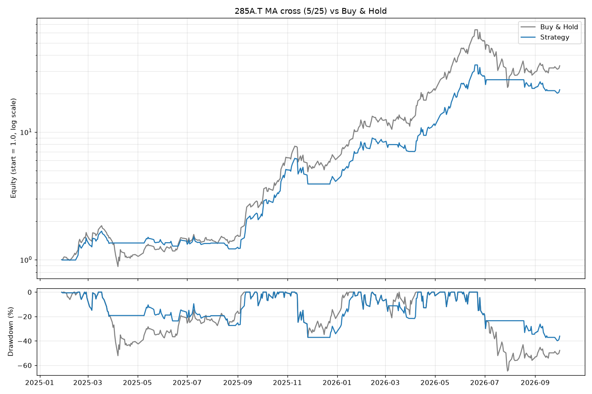
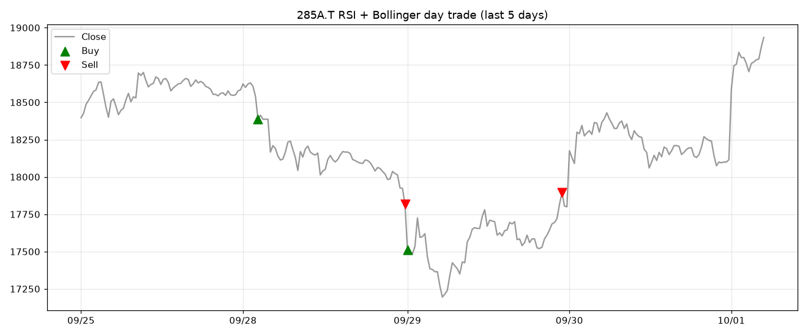

# 株の売買ルール検証ツール

「ゴールデンクロスで買い、デッドクロスで売る」のような**規則的な売買ルールが、買ってずっと持っているだけ(ガチホ)に勝てるのか**を、過去の株価で検証するツールです。

- コマンドライン版と、ブラウザで使える Web 版(Streamlit)があります
- 手数料込みで、戦略とガチホを同じ期間・同じ条件で比較します
- 利益率だけでなく、最大ドローダウン・シャープレシオ・勝率などで評価します

> ⚠️ 学習・検証目的のツールです。投資助言ではありません。

## 作った動機

ジュニア NISA の頃から投資をしていて、今は NISA での長期保有に加えて短期売買もしています。短期売買をする中で、**「ずっと保有したときの利益率を、規則的なロジックに従った自動売買で上回れるのか」** に興味を持ち、2026年3月に最初のバージョンを作りました。

検証する銘柄には、性格の違う半導体関連株を選びました。

| 銘柄 | 選んだ理由 |
|---|---|
| キオクシア(285A.T) | メモリ価格などの外部要因に大きく左右され、短期間で値動き(ボラティリティ)が大きい |
| アドバンテスト(6857.T) | 半導体の検査装置で大きなシェアを持ち、比較的安定している |
| 東京エレクトロン(8035.T) | 半導体の製造装置で大きなシェアを持ち、比較的安定している |

値動きの性格が違う銘柄で、同じルールの結果がどう変わるかを比べたいと考えました。

## 分かったこと

### 移動平均クロス(5日線・25日線)とガチホの比較

手数料は片道 0.1%。データは 2026-10-01 に取得しました(この日は取引時間中だったため、最終日の値は暫定です)。

| 銘柄 | 期間 | 戦略 利益率 | ガチホ 利益率 | 戦略 最大DD | ガチホ 最大DD | 戦略 シャープ | ガチホ シャープ | 売買回数 | 勝率 |
|---|---|---|---|---|---|---|---|---|---|
| キオクシア | 2025-01〜2026-10 | +2,043.5% | **+3,202.5%** | **-39.9%** | -64.7% | **2.64** | 2.57 | 16 | 53.3% |
| アドバンテスト | 2024-11〜2026-10 | +108.0% | **+283.0%** | **-33.3%** | -51.4% | 1.01 | **1.39** | 13 | 41.7% |
| 東京エレクトロン | 2024-11〜2026-10 | **+267.8%** | +181.1% | **-20.2%** | -37.1% | **1.92** | 1.31 | 11 | 60.0% |

(最大DD = 最大ドローダウン。資産が途中の高値から最も大きく減った割合。シャープ = シャープレシオ。値動きのブレ1単位あたりのリターンで、高いほど効率がよい)



1. **利益率では、3銘柄中2銘柄でガチホに負けました。** 3月版では「+2,000%」という結果だけを見て喜んでいましたが、ガチホと比べると、キオクシアでは利益を約3分の2に減らしていました。
2. **一方、最大ドローダウンは3銘柄すべてで小さくなりました。** 下落局面で現金に逃げるので、途中の資産の減り方はガチホの約半分〜3分の2で済んでいます。「利益は減るが、大きな下落は避けられる」というトレードオフがあります。
3. **勝ち負けを分けたのは、株を持っていなかった期間の値動きでした。**

   | 銘柄 | 戦略が持っていた日の値動き | 戦略が持っていなかった日の値動き | 結果 |
   |---|---|---|---|
   | キオクシア | 22.14倍 | **1.49倍(上昇を取り逃した)** | 負け |
   | アドバンテスト | 2.14倍 | **1.80倍(上昇を取り逃した)** | 負け |
   | 東京エレクトロン | 3.76倍 | **0.75倍(下落を避けた)** | 勝ち |

   移動平均は過去の平均なので、トレンドの変化に気づくのが遅れます。上昇が続く相場では、一時的な下げで売ってしまい、その後の上昇を取り逃します。東京エレクトロンは 2026年7月以降に大きく下げた期間があり、そこで現金にしていたことが効きました。
4. **当初の仮説(値動きが激しい銘柄と安定した銘柄で結果が分かれる)は、はっきりとは確認できませんでした。** 同じ製造装置系でも、アドバンテストは負け、東京エレクトロンは勝ちました。結果を分けたのは銘柄の性格よりも、**検証期間に長い下落局面があったかどうか**だと考えています。ただし3銘柄・約2年では少なすぎて、結論は出せません。
5. **期間を5年に延ばしても、ガチホを上回るのは難しい結果でした。** アドバンテストは戦略 +478.9% に対してガチホ +1,420.0%、東京エレクトロンは +259.5% に対して +277.4% でした。ただし、どちらも最大ドローダウンは戦略のほうが小さくなっています(-35.6% 対 -51.4%、-39.3% 対 -55.8%)。
6. **手数料の影響は小さめでした。** 売買が2年で十数回と少ないためです。手数料を 0% にしても、キオクシアの利益率は +2,112.5% で、ガチホには届きません。

### デイトレ戦略(RSI + ボリンジャーバンド、5分足)

売られすぎ(RSI < 30 かつ バンド下限割れ)で買い、買われすぎ(RSI > 70 かつ バンド上限超え)で売る逆張り戦略です。翌日に持ち越さないよう、大引けで必ず手仕舞いします。5分足は Yahoo Finance の制限で直近60日分しか取れないため、期間は 2026-07-03〜2026-10-01 です。

| 銘柄 | 戦略 利益率 | ガチホ 利益率 | 戦略 最大DD | ガチホ 最大DD | 売買回数 | 勝率 |
|---|---|---|---|---|---|---|
| キオクシア | -36.7% | -29.5% | -41.7% | -55.2% | 32 | 37.5% |
| アドバンテスト | -2.7% | +27.4% | -14.5% | -23.4% | 28 | 53.6% |
| 東京エレクトロン | +2.0% | -13.3% | -19.1% | -35.2% | 28 | 64.3% |



キオクシアは2026年7月下旬に急落し(7月24日 18,670円 → 29日 12,793円)、損失の大きい取引はこの時期に集中していました。逆張り戦略は「売られすぎ」と判断して買いますが、**急落が続く相場ではさらに下がって損をする**という弱点がはっきり出ました。下落トレンドのときは買わない、といったフィルターが必要だと考えています。

## 3月版からの改善

最初のバージョン(2026年3月)を見直し、次の問題を見つけて直しました。経緯はコミット履歴でも追えます。

| 問題 | 対応 |
|---|---|
| ガチホと比較していなかった(コメントには「比較」と書いていたのに未実装) | 同じ期間・同じ手数料でガチホと比較 |
| 手数料を考慮していなかった | 売買のたびにコストを差し引く(デフォルト 0.1%) |
| 評価が最終利益率だけだった | 最大ドローダウン・シャープレシオ・保有率・売買回数・勝率を追加 |
| デイトレ戦略で、株を持っていないのに「売り」シグナルが出ていた | 保有状態を管理し、持っているときだけ売る |
| デイトレ戦略はシグナルを表示するだけで、検証していなかった | バックテストを追加し、大引けで手仕舞いするルールに |
| メンテナンスが滞っている pandas_ta に依存していた | RSI とボリンジャーバンドを自前で実装 |

## 使い方

Python 3.11 以上が必要です。

```bash
git clone https://github.com/standwind8810/stock-backtest.git
cd stock-backtest
python -m venv .venv
# Windows: .venv\Scripts\activate   macOS/Linux: source .venv/bin/activate
pip install -r requirements.txt
```

### Web 版

```bash
streamlit run app.py
```

ブラウザが開き、銘柄・期間・移動平均の日数・手数料を変えながら結果を確認できます。

### コマンドライン版

```bash
# 最新のゴールデンクロス/デッドクロスを判定
python -m stock_backtest check 285A.T 6857.T 8035.T

# 移動平均クロス戦略をガチホと比較(日数や期間、手数料を変えられる)
python -m stock_backtest backtest 285A.T --short 5 --long 25 --period 2y --cost 0.001

# 複数銘柄をまとめて比較し、Markdown の表を出力
python -m stock_backtest compare 285A.T 6857.T 8035.T

# デイトレ戦略を5分足で検証
python -m stock_backtest daytrade 285A.T
```

グラフは `output/` に保存されます(`--out` で変更可)。各コマンドの詳しいオプションは `-h` で確認できます。

## 設計で気をつけたこと

- **未来のデータを使わない(ルックアヘッドバイアスの回避)**: ある日の終値を見て決めたポジションは、翌日の値動きにだけ反映します(`position.shift(1)`)。シグナルが出た日の値上がりを取れたことにすると、成績が実際より良く見えてしまいます。テスト `test_未来のデータを使わない` で確認しています。
- **公平な比較**: 25日移動平均は最初の25日間は計算できないので、その期間は戦略もガチホも比較から除いています。ガチホにも最初の1回分の手数料をかけています。
- **株式分割の調整**: 分割の前後で価格が飛ばないよう、調整後の価格を使っています。
- **指標の自前実装**: RSI は Wilder の平滑化で計算し、pandas_ta と同じ値になることを確認しました。ボリンジャーバンドは、pandas_ta が標本標準偏差(ddof=1)を使っていたのに対し、Bollinger の定義どおり母標準偏差(ddof=0)にしています。

```
stock_backtest/
├── data.py         # 株価の取得(Yahoo Finance)
├── indicators.py   # 移動平均・RSI・ボリンジャーバンド
├── strategies.py   # 売買ルール(ポジションを 1/0 で返す)
├── backtest.py     # 手数料込みのバックテストとガチホとの比較
├── metrics.py      # 評価指標
├── report.py       # 結果の表
├── plot.py         # グラフ
└── cli.py          # コマンドライン
app.py              # Web 版(Streamlit)
tests/              # テスト(ネットに接続せず、作ったデータで確認)
```

## テスト

```bash
pip install -r requirements-dev.txt
pytest
```

ネットワークに接続せず、結果が分かっているデータで、指標の計算・売買ルール・バックテスト(未来のデータを使わないこと、手数料、勝率、最大ドローダウンなど)を確認しています。

## 限界と注意点

- 売買は「シグナルが出た足の終値」で約定したと仮定しています。実際には、その価格で買えるとは限りません。
- 検証は3銘柄・約2年(5分足は60日)だけです。たまたまの結果である可能性があります。
- 現在も上場している銘柄だけを選んでいるので、成績が良く見えやすい偏り(生存者バイアス)があります。
- 税金は考慮していません。
- Yahoo Finance の5分足には、一部の日が欠けていることがあります(例: 2026-07-31)。
- パラメータ(5日・25日など)を過去のデータに合わせて調整しすぎると、将来には通用しない(過学習)おそれがあります。

## 今後やりたいこと

- 検証期間を「パラメータを決める期間」と「確かめる期間」に分けて、過学習していないか確かめる(ウォークフォワード検証)
- デイトレ戦略に、下落トレンドでは買わないフィルターを入れる
- 半導体以外の業種や、より多くの銘柄で検証する
- 約定価格を「翌日の始値」にするなど、より現実に近い条件で検証する

## 開発での AI(Claude Code)の使い方

このプロジェクトは Claude Code と対話しながら開発しました。

- **自分で決めたこと**: 検証したい問い(ガチホに勝てるか)、銘柄の選び方とその理由、どの問題を直すかの判断
- **Claude Code に任せたこと**: 3月版のコードレビュー、改善案の洗い出し、実装とテストコードの作成
- **自分で確かめたこと**: 結果の数字が実際の株価と合っているか、未来のデータを使っていないか、ボリンジャーバンドが pandas_ta と違う値になる理由

<!-- TODO: 自分の言葉で書き直す(AI の提案を採用しなかった点、自分で気づいた点など) -->

## ライセンス

[MIT License](LICENSE)
